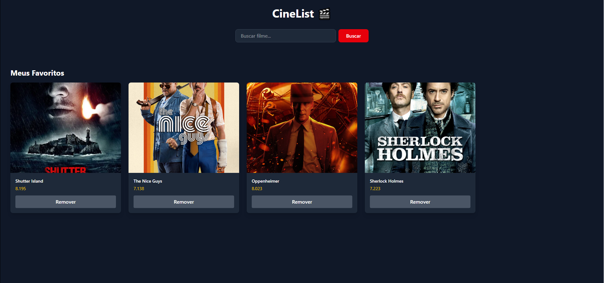

# 🎬 CineList

Aplicação fullstack para buscar filmes e montar sua lista de favoritos.

🔗 **Acesse ao vivo:** [cinelist-frontend-two.vercel.app](https://cinelist-frontend-two.vercel.app/)



## ✨ Funcionalidades

- 🔍 Busca de filmes em tempo real pela API do TMDB
- ❤️ Adicionar filmes aos favoritos
- 🗑️ Remover favoritos
- 💾 Favoritos salvos em banco de dados (persistem entre sessões)
- 📱 Interface responsiva com tema escuro

## 🛠️ Tecnologias

**Front-end:** React, Vite, Tailwind CSS
**Back-end:** Node.js, Express ([repositório da API](https://github.com/Victorornellas/cinelist-backend))
**Banco de dados:** MongoDB (Atlas)
**APIs externas:** TMDB
**Deploy:** Vercel (front-end) e Render (back-end)

## 🚀 Como rodar localmente

```bash
# 1. Clonar o repositório
git clone https://github.com/Victorornellas/cinelist-frontend.git

# 2. Entrar na pasta
cd cinelist-frontend

# 3. Instalar as dependências
npm install

# 4. Rodar o projeto
npm run dev
```

### Variáveis de ambiente

Crie um arquivo `.env` na raiz com:

```dotenv
VITE_TMDB_API_KEY=sua_chave_da_tmdb
VITE_API_URL=url_da_sua_api
```

